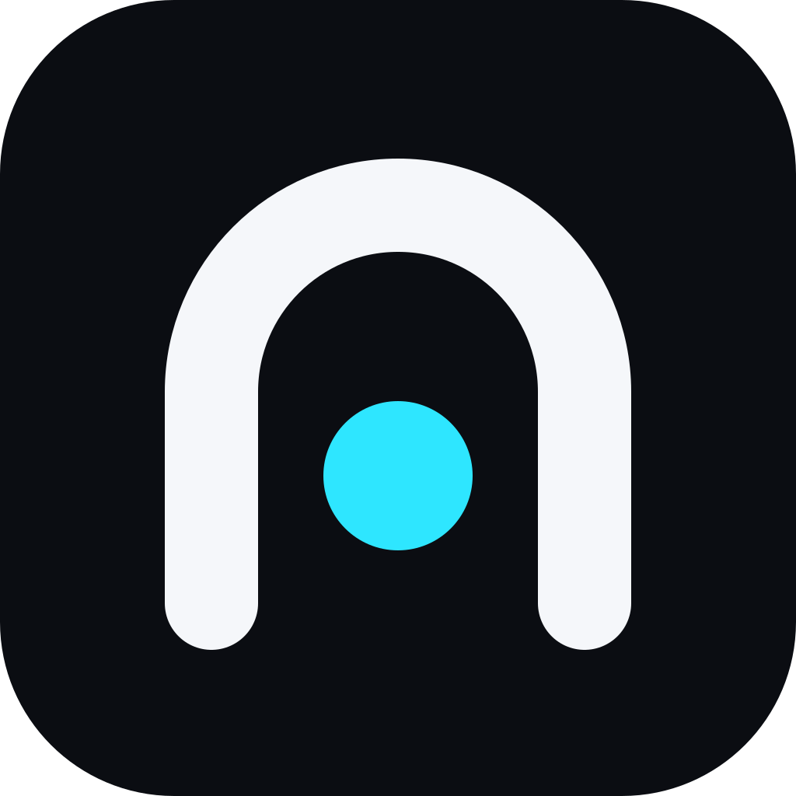

<div align="center">
  

  # A1O Platform

  **Una pasarela de IA compatible con las API de OpenAI, Anthropic y Gemini.**

  [](https://github.com/infinmalum/a1o-platform/actions/workflows/ci.yml)
  [](LICENSE)
  
  

  [English](README.md) · [简体中文](README.zh-CN.md) · [日本語](README.ja.md) · [Français](README.fr.md) · [Русский](README.ru.md) · Español
</div>

---

A1O Platform es una pasarela de IA derivada de [One API](https://github.com/songquanpeng/one-api) y mantenida de forma independiente. Una sola instancia da acceso a varios proveedores de modelos con los formatos nativos de OpenAI Chat Completions, OpenAI Responses, Anthropic Messages y Gemini generateContent. Incluye Studio para usuarios y una consola para administrar canales, usuarios, tokens, cuotas y registros de uso. JustSong y otros colaboradores crearon One API.

> [!NOTE]
> A1O Platform publica y mantiene sus propias versiones. Las versiones, imágenes Docker, sitios de demostración y canales de soporte de One API pertenecen al proyecto original.

## Funciones principales

- 🔌 **Cuatro formatos nativos de API** — OpenAI Chat Completions, OpenAI Responses (con ejecuciones en segundo plano que se pueden consultar o cancelar), Anthropic Messages y Gemini `generateContent`. El mismo token da acceso a las API de embeddings, imágenes, audio y moderación.
- 🌉 **Conversión entre protocolos** — la pasarela convierte solicitudes y respuestas, incluso en streaming. Los clientes OpenAI pueden usar canales Anthropic, Gemini y Responses. Los clientes Anthropic pueden usar canales OpenAI Chat y Gemini.
- 🔀 **Enrutamiento de solicitudes** — balanceo de carga entre canales, asignación de nombres de modelo, multiplicadores por grupo, conexión de cuentas de suscripción mediante OAuth (ChatGPT, Claude Code, Gemini CLI), prioridad configurable para las suscripciones y reintentos automáticos antes de enviar el primer byte al cliente.
- 🤖 **Motor conversacional integrado** — Chat y Work comparten el ciclo de herramientas de [Norma](https://github.com/infinmalum/norma-e), con sesiones persistentes, ejecución aislada de código Python y Node (límites de recursos con rlimits y aislamiento de red) y servidores de herramientas MCP (Model Context Protocol).
- 🧮 **Cuotas y facturación** — cuotas por token, registros de uso, códigos de canje, recargas y cálculo del coste de cada solicitud según las tarifas configuradas.
- 🖥️ **Aplicaciones web** — Studio en `/` incluye Chat con un Playground multiprotocolo, tareas Work en segundo plano, una biblioteca de agentes, bibliotecas privadas de documentos y herramientas de imagen, vídeo y audio. La consola en `/admin/` gestiona canales, cuentas de proveedores, usuarios, tokens, registros y ajustes.
- 💾 **Almacenamiento flexible** — PostgreSQL por defecto en Docker Compose, con soporte para SQLite y MySQL y Redis para la caché y la sincronización. Admite despliegues con un nodo principal y nodos secundarios.
- 🛠️ **Tecnologías** — servidor en Go e interfaces en TypeScript con Vite. Cada compilación de las interfaces comienza con una comprobación de tipos.

La disponibilidad de modelos y funciones depende del tipo de canal. Revisa su configuración y prueba el modelo antes de usarlo en producción.

## Usar Studio

Configura un canal de proveedor y habilita los modelos para tu grupo en la consola de administración. Inicia sesión en Studio y selecciona un modelo. Playground y las herramientas multimedia usan tu sesión de Studio. Las llamadas a los modelos se descuentan de la cuota de la cuenta.

| Pantalla | Qué puedes hacer |
| --- | --- |
| **Chat → Playground** | Envía solicitudes nativas de OpenAI Chat Completions, OpenAI Responses, Anthropic Messages o Gemini. Consulta el JSON sin procesar y los eventos del flujo, compara dos modelos con la misma solicitud y copia un ejemplo de cURL. |
| **Espacio de trabajo → Bibliotecas de conocimiento** | Sube archivos privados TXT, Markdown, CSV, TSV, PDF, DOCX, XLSX, PPTX, JPEG, PNG, GIF o WebP. Chat busca en el texto extraído y enlaza los fragmentos citados. Por defecto se permiten 16 MiB por archivo, 256 MiB por biblioteca y hasta 64 archivos. Un administrador puede cambiar ambos límites de tamaño. Consulta la [guía de bibliotecas](docs/knowledge-libraries.md). |
| **Generación de imágenes → Imagen / Vídeo** | Genera imágenes con modelos compatibles, incluidos Seedream en Volcengine Ark y Gemini. Previsualiza o descarga los originales y adjúntalos a Chat o Work. Seedream y los modelos de imagen Gemini compatibles aceptan referencias PNG, JPEG y WebP. Seedance en Ark genera vídeos de 5 a 8 segundos en 720p a partir de texto, con un primer fotograma opcional. Gemini `gemini-omni-1.2-flash` genera vídeos de 3 a 8 segundos en 360p a partir de texto. |
| **Audio** | Usa un modelo compatible para sintetizar voz, transcribir audio o traducir voz al inglés. Reproduce y descarga el audio o exporta la transcripción. |
| **Cuenta → Canjear** | Canjea un código o compra un paquete de cuota de pago único mediante Stripe Checkout, Airwallex, EPay V1/V2, NOWPayments o GMPay Edge, según los métodos habilitados. |

El administrador fija las tarifas de los modelos de Ark con `ARK_MEDIA_PRICES` y los precios de los paquetes con `PAYMENT_PACKAGES`. Stripe, Airwallex, NOWPayments y GMPay usan centavos de dólar. EPay usa un precio independiente en fen de yuan. Habilita las monedas y redes de NOWPayments con `NOWPAYMENTS_PAY_CURRENCIES` y configura los métodos de recepción de GMPay en GMPay Edge. La [guía multimedia y de pagos](docs/media-and-payments.md) describe la configuración y las pruebas.

El encabezado de Studio permite elegir entre diez idiomas de interfaz, con escritura de derecha a izquierda para árabe y persa. La consola de administración permite elegir entre chino e inglés de forma independiente.

Una sola instancia puede usar SQLite sin Redis ni una base vectorial. Conserva la base de datos y el volumen de datos al hacer copias de seguridad o migrar. Los adjuntos de Chat y las imágenes y vídeos generados se guardan en disco.

Tras iniciar sesión, el catálogo muestra los modelos habilitados y permite filtrar por grupo, categoría y nombre.

## Inicio rápido con Docker

Las instrucciones predeterminadas compilan la aplicación desde el código fuente. Para usar una imagen precompilada en Linux amd64, consulta las [instrucciones de GHCR](docs/database-deployment.md#deploy-a-prebuilt-image-from-ghcr).

Para una instalación nueva, ejecuta estos comandos en un entorno con Docker Compose y OpenSSL.

```sh
git clone https://github.com/infinmalum/a1o-platform.git
cd a1o-platform
umask 077
cp .env.example .env
printf 'POSTGRES_PASSWORD=%s\nSESSION_SECRET=%s\n' "$(openssl rand -hex 32)" "$(openssl rand -hex 32)" >> .env
docker compose up -d
```

En el primer arranque, abre <http://localhost:3000/admin/setup> para crear la cuenta root. Para una instalación desatendida, pasa `INITIAL_ROOT_PASSWORD` al contenedor antes de iniciarlo por primera vez. Tras la inicialización, abre Studio en <http://localhost:3000/> o la consola en <http://localhost:3000/admin/>. Conserva el volumen de datos al sustituir el contenedor. Para un despliegue público, configura HTTPS y un valor persistente de `SESSION_SECRET`.

El despliegue predeterminado de Compose inicia PostgreSQL y guarda sus datos en `./data/postgres`. Para SQLite o una base PostgreSQL o MySQL existente, ejecuta `docker compose -f docker-compose.external.yml up -d` y configura `SQL_DSN` para una base externa. Redis es opcional.

Para actualizar una instalación anterior con MySQL incluido, conserva el directorio del proyecto y las credenciales y ejecuta `docker compose -f docker-compose.mysql.yml up -d`. Haz una copia de seguridad, transfiere y verifica los datos antes de cambiar de base. Consulta las instrucciones y el procedimiento de reversión en la [guía de bases de datos](docs/database-deployment.md).

## Compilar desde el código fuente

Usa Node.js 24, Go 1.27.1 y un compilador de C para el controlador SQLite con CGO. Ejecuta los comandos desde la raíz del repositorio.

```sh
npm ci --legacy-peer-deps --prefix web/studio
npm run build --prefix web/studio
npm ci --legacy-peer-deps --prefix web/admin
npm run build --prefix web/admin
go build -o a1o-platform .
./a1o-platform --port 3000
```

Vite escribe las aplicaciones en `web/build/studio` y `web/build/admin`. El binario de Go incorpora las dos. Norma ejecuta el ciclo de modelos y herramientas de Chat y Work. A1O proporciona las herramientas autorizadas y gestiona el enrutamiento, la facturación, la persistencia y la programación de tareas.

## Configurar y usar la pasarela

Define las variables de entorno antes de iniciar el servidor.

| Variable | Propósito |
| --- | --- |
| `PORT` | Puerto HTTP. Por defecto, `3000`. |
| `SQL_DSN` | DSN de MySQL o URL `postgres://`. Si no se configura, se usa SQLite. |
| `SQLITE_PATH` | Ruta del archivo de base de datos SQLite. |
| `SESSION_SECRET` | Secreto de sesión persistente, especialmente útil con reinicios o réplicas. |
| `REDIS_CONN_STRING` | URL de conexión a Redis para la caché. |
| `SYNC_FREQUENCY` | Intervalo de sincronización de la caché en segundos. |
| `NODE_TYPE` | `master` o `slave` en un despliegue con varios nodos. |
| `FRONTEND_BASE_URL` | URL opcional de redirección de la interfaz de un nodo secundario. |

Con varias instancias, conecta todos los nodos a la misma base MySQL o PostgreSQL, usa el mismo `SESSION_SECRET` y configura los roles de los nodos y la sincronización de la caché. Consulta el paquete [`common/config`](common/config) para conocer las opciones admitidas.

Tras iniciar sesión, añade una clave de proveedor en **Canales** y crea un token de acceso en **Tokens**. El mismo token autentica a los clientes en todos los endpoints.

| Formato del cliente | Endpoint |
| --- | --- |
| OpenAI Chat Completions | `POST /v1/chat/completions` |
| OpenAI Responses | `POST /v1/responses` (segundo plano: `GET /v1/responses/{id}`, `POST /v1/responses/{id}/cancel`) |
| Anthropic Messages | `POST /v1/messages` |
| Gemini | `POST /v1beta/models/{model}:generateContent` o `:streamGenerateContent` (también en `/v1`) |
| OpenAI Embeddings | `POST /v1/embeddings` |
| Imágenes, audio y moderación de OpenAI | `POST /v1/images/generations`, `/v1/audio/speech`, `/v1/audio/transcriptions`, `/v1/audio/translations`, `/v1/moderations` |
| Evaluación SystemOne | `POST /v1/systemone` |

La conversión permite que un cliente Anthropic use un canal OpenAI Chat o Gemini. Las solicitudes OpenAI Chat también pueden usar cuentas de suscripción de ChatGPT a través del formato Responses.

Usa `http://localhost:3000/v1` como URL base en un cliente compatible con OpenAI y el token como clave de API.

```sh
curl http://localhost:3000/v1/chat/completions \
  -H 'Content-Type: application/json' \
  -H 'Authorization: Bearer YOUR_TOKEN' \
  -d '{"model": "gpt-4o", "messages": [{"role": "user", "content": "Hello!"}]}'
```

## Documentación

- [Desarrollo de las interfaces web](web/README.md)
- [Privacidad de la cuenta, memoria y eliminación de datos](docs/privacy.md)

## Desarrollo

- Comprueba los tipos con `npm run typecheck --prefix web/studio` o `npm run typecheck --prefix web/admin` según la aplicación que edites. Compila ambas aplicaciones antes de generar un binario con los recursos actualizados.
- Para cambios en el servidor, ejecuta `go test ./...`.

Informa de problemas y propone cambios en el [gestor de incidencias del repositorio](https://github.com/infinmalum/a1o-platform/issues).

## Origen y licencias

A1O Platform deriva de [One API](https://github.com/songquanpeng/one-api), copyright © 2023 JustSong y demás colaboradores. La licencia MIT y el aviso del proyecto original se conservan en [`LICENSE.upstream`](LICENSE.upstream). Los cambios originales de A1O Platform se distribuyen bajo la [licencia GNU Affero General Public v3.0 (AGPL-3.0)](LICENSE). Consulta [`NOTICE`](NOTICE) para conocer la atribución y el alcance. Siguen vigentes los avisos de licencia de archivos concretos y dependencias de terceros.
